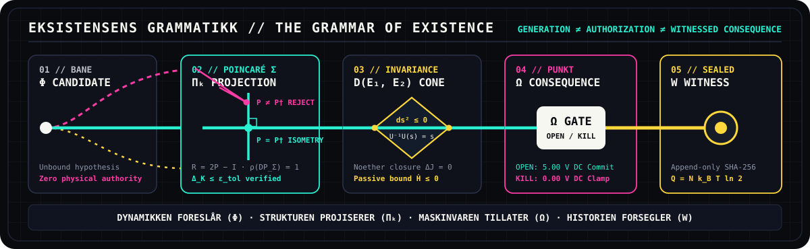

# SOLOLYS // EKSISTENSENS GRAMMATIKK
### *Marius Egerhei Torjusen · Independent Researcher & Systems Architect · Risør, Norway*
[](https://orcid.org/0009-0006-0431-6637)
[](https://www.linkedin.com/in/marius-torjusen-9aa392392/)
[](https://github.com/sponsors/sololys)
[](https://kreativ-systems.org/)

<p align="center">
  
</p>

```text
PUBLIC_TREE_GATE = PASS
MICROTEST_GATE = PASS (24/24)
SCOPE = EXACT_CHECKED_TREE_ONLY
CLAIM_STATUS = HOLD
PHYSICAL_AUTHORITY = NONE
OPERATIONAL_AUTHORITY = NONE
```

---

## I. GRUNNLOVEN

En bit fødes ikke som $1$. Den autoriseres til $1$.

Virkelighet genereres ikke lokalt; den slippes inn lokalt. Mellom et generert forslag og en fysisk konsekvens står en ufravikelig port. Det som mangler bevis, hviler. Det som bryter geometrien, kuttes.

$$\text{GENERATION} \neq \text{AUTHORIZATION} \neq \text{WITNESSED CONSEQUENCE}$$

La $\mathcal{X}$ være tilstandsrommet, $K \subset \mathcal{X}$ det lovlige underrommet, og $\Pi_K : \mathcal{X} \to K$ den strukturelle projeksjonen. Ingen kandidat $x \in \mathcal{X}$ passerer til virkelighet uten at residualet $\Delta_K(x) = \|x - \Pi_K(x)\|$ er under eksakt terskel $\tau_K$, ledsaget av et eksplisitt vitne $e$:

$$\Omega(x, e, \Delta_K) = \begin{cases} \text{OPEN} & \text{hvis } e \neq \varnothing \land \Delta_K(x) \le \tau_K \\ \text{HOLD} & \text{hvis } e = \varnothing \\ \text{KILL} & \text{hvis } \Delta_K(x) > \tau_K \end{cases}$$

Tid alene åpner ingen port ($\partial_t \text{HOLD} = 0$). Historikk slettes aldri; den kun tilføyes ($\rho(\text{DP}) \ge 1$).

---

## II. DE FIRE MONOLITTENE

Det offentlige utstillingsvinduet ([`sololys/ky-rox-public-demonstrators`](https://github.com/sololys/ky-rox-public-demonstrators)) inneholder fire lukkede, deterministiske mikrotester. De utgjør til sammen et fullstendig koordinatsystem for autorisert realisering: **Konsekvens**, **Rom**, **Bane** og **Relasjon**.

### 1. KONSEKVENS: [Lysbrua — LightBridge Consequence Gate v0.1](https://github.com/sololys/ky-rox-public-demonstrators/tree/main/artifacts/microtests/light_bridge_consequence_gate_v0_1)
Et forslag har ingen bærehjelp i seg selv. Bæreevne er en tilstand som må innvilges og opprettholdes mot et aktivt vitne.
* **Loven:** $\text{HOLD} \nrightarrow \text{OPEN}$ ved blott tidsforløp. Okkupert sone blokkerer realisering. Ved $\text{KILL}$ kuttes kollisjonsgeometrien i $\Delta t = 0$, og ethvert ventende løfte annulleres. `reset()` skriver ny linje i vitneloggen uten å røre fortiden.
* **Artefakt:** `light_bridge.gd` (Godot 4) + `light_bridge_gate.py` (**6/6 PASS**).

### 2. ROM: [ISAC Fase-Kjeglen — Euclidean Wavefront Phase-Cone Gate v0.1](https://github.com/sololys/ky-rox-public-demonstrators/tree/main/artifacts/microtests/euclidean_phase_cone_isac_v0_1)
Det fysiske rommet har en skarp rand. Bølger som stammer fra virkeligheten adlyder enhetssirkelen; syntetiske injeksjoner faller utenfor og avslører seg i det imaginære planet.
* **Loven:** For elementavstand $d = \frac{\lambda}{2}$ er innfallsvinkelen bundet av $\sin(\theta) = \frac{\Delta\phi}{\pi}$. Så lenge $\left|\frac{\Delta\phi}{\pi}\right| \le 1$, er $\cos(\theta) \in \mathbb{R}$ og porten står `OPEN`. Straks $\left|\frac{\Delta\phi}{\pi}\right| > 1$, tvinges $\cos(\theta) = i\sqrt{\sin^2\theta - 1} \in i\mathbb{R}_{>0}$, og porten utløser momentan `KILL`.
* **Artefakt:** `euclidean_phase_cone.py` (**6/6 PASS**).

### 3. BANE: [PUNKT // BANE — P–NP Yin–Yang Bin Packing v0.1](https://github.com/sololys/ky-rox-public-demonstrators/tree/main/artifacts/microtests/p_np_yinyang_binpacking_v0_1)
Å gjette et sluttpunkt er ikke å bygge en vei. Et uregulert postulat og en verifisert konstruksjon tilhører to ulike ontologiske klasser.
* **Loven:** Skiller et isolert kandidatpunkt (NP-sertifikat $C$) fra en sekvensielt bevist konstruksjonsbane ($\gamma : x_0 \xrightarrow{W_{\text{PRE}}, W_{\text{POST}}} x_n$). Ingen tilstand godtas uten at kjeden av forutgående og etterfølgende vitner er lukket. Teoretiske utvidelser holdes strengt i `p_equals_np_claim_status = HOLD`.
* **Artefakt:** `yinyang_binpacking.py` (**6/6 PASS**).

### 4. RELASJON: [Kernel Drift Observable v0.1](https://github.com/sololys/ky-rox-public-demonstrators/tree/main/artifacts/microtests/kernel_drift_observable_v0_1)
Koordinater kan bedra; indre proporsjoner lyver aldri. Et system endrer ikke sin natur fordi rommet dreies rundt det, men det dør i det øyeblikket vinklene mellom dets egne deler brister.
* **Loven:** Punktvis tilstandsdrift $\Delta_{\text{state}} = \|X(t) - X(0)\|_F$ er blind for forskjellen mellom stiv rotasjon ($U \in O(d)$) og indre kollaps. Gram-kjernen $G(t) = X(t)^\top X(t)$ isolerer systemets sanne geometri: under ren rotasjon er $\Delta_G = \|G(t) - G(0)\|_F = 0$ (`OPEN`), mens indre skjær- og spektralbrudd gir $\Delta_G > \tau_G$ (`KILL`).
* **Artefakt:** `kernel_drift.py` (**6/6 PASS**).

---

## III. TOPOLOGISK MATRISE

| Monolitt | Ontologisk Akse | Operator / Observabel | Bruddkriterium ($\to \text{KILL}$) | Status |
| :--- | :--- | :--- | :--- | :--- |
| **1. Lysbrua** | Tid & Konsekvens | $\Omega_{\text{bridge}}(e, \text{Zone})$ | Eksplisitt avbrudd / ulovlig overgang | `6/6 PASS` |
| **2. Fase-Kjeglen** | Euklidsk Rom | $\sin(\theta) = \Delta\phi / \pi$ | $\lvert\Delta\phi / \pi\rvert > 1 \implies \cos\theta \in i\mathbb{R}$ | `6/6 PASS` |
| **3. Punkt // Bane** | Konstruksjon | $\gamma(W_{\text{PRE}}, W_{\text{POST}})$ | Brutt vitnekjede / uverifisert hopp | `6/6 PASS` |
| **4. Kernel Drift** | Indre Geometri | $\Delta_G = \|X_t^\top X_t - X_0^\top X_0\|_F$ | $\Delta_G > \tau_G \lor \lambda_{\min}(G_t) < 0$ | `6/6 PASS` |

---

## IV. EPISTEMISK GRENSEMURS-ERKLÆRING

$$\text{INSPIRED\_BY} \neq \text{IMPLEMENTS} \neq \text{PROVES}$$

1. **Null Autonomi:** Koden i dette treet besitter $0.00\%$ juridisk, operasjonell eller fysisk makt (`PHYSICAL_AUTHORITY=NONE`). All suverenitet hviler udelt hos *Level 01 Supreme Human Authority*.
2. **Eksakt Omfang:** Verifikasjonen (`24/24 PASS`) gjelder utelukkende de matematiske og logiske egenskapene til det sjekkede treet (`SCOPE=EXACT_CHECKED_TREE_ONLY`).
3. **Låst Påstand:** Alle åpne teoretiske ekstrapolasjoner er frosset i `CLAIM_STATUS=HOLD`.

---
*ReismannPoint Systems AS — Risør, Norge · [ORCID: 0009-0006-0431-6637](https://orcid.org/0009-0006-0431-6637) · [kreativ-systems.org](https://kreativ-systems.org/)*
